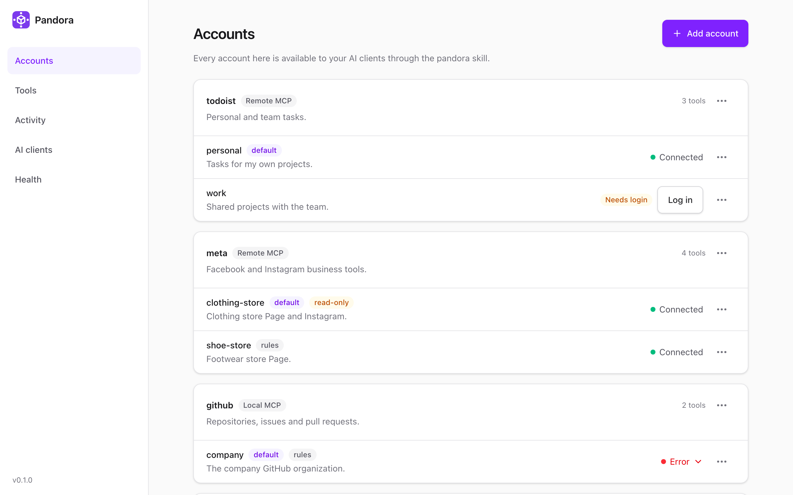

# Pandora

One CLI that connects all your accounts and services to every AI client.

[](https://github.com/PierreOliveira1/pandora/actions/workflows/ci.yml)
[](https://github.com/PierreOliveira1/pandora/releases/latest)
[](LICENSE)

Every AI app has its own way to set up each service. Two accounts of the same service often do not fit, tokens end up in config files, and there is no single place to see or limit what an AI can do. Pandora keeps every integration in one local binary: you add a service once, add as many accounts as you need, and every AI client uses the same setup. Pandora stays generic: a remote MCP server, a local MCP server, an OpenAPI spec or your own commands all become tools.



## Features

- Any source becomes a tool: remote MCP, local MCP, OpenAPI 3.x or Swagger 2.0, and your own commands.
- Many accounts per service, each with its own credentials: `todoist/personal` and `todoist/work` side by side.
- One setup for Claude Code, Codex, OpenCode, Cursor and Claude Desktop.
- OAuth with automatic discovery, dynamic client registration and PKCE, or your own client ID when a provider requires it.
- Secrets in the OS keychain, never in the config file.
- Light on context: the CLI plus a generated skill by default, or one MCP server for clients without skills.
- A shared background daemon keeps upstream connections open between calls.
- Read-only, allow and deny rules, a local call log and a local web UI.

## Install

With the install script (macOS, Linux and FreeBSD):

```sh
curl -fsSL https://raw.githubusercontent.com/PierreOliveira1/pandora/main/install.sh | sh
```

It installs to `~/.local/bin` and verifies the sha256 checksum. Set `PANDORA_VERSION` to install a specific version and `PANDORA_INSTALL_DIR` to change the directory.

Or download an archive from [releases](https://github.com/PierreOliveira1/pandora/releases) (Linux, macOS, Windows and FreeBSD; amd64 and arm64; `checksums.txt`). Windows support is experimental.

Or install from source with Go 1.27 or newer. The web UI is already embedded in the binary:

```sh
go install github.com/PierreOliveira1/pandora/cmd/pandora@latest
```

Check the version:

```sh
pandora --version
```

## Quick start

1. Add a remote MCP server that uses OAuth. Run this in a terminal so Pandora can start the login:

   ```sh
   pandora add todoist --as personal --url https://ai.todoist.net/mcp
   ```

2. Add a second account of the same service. The service definition already exists, so the URL is not repeated:

   ```sh
   pandora add todoist --as work
   ```

   Open the printed login URL in a private window for the second account. If Pandora only prints a login hint, run `pandora auth todoist/work`.

3. Add a local MCP server with a secret environment variable:

   ```sh
   pandora add github --as work \
     --secret-env GITHUB_PERSONAL_ACCESS_TOKEN=YOUR_TOKEN \
     -- npx -y @modelcontextprotocol/server-github
   ```

   Without `=VALUE`, Pandora prompts for the secret.

4. Install the skill in the AI clients Pandora detects:

   ```sh
   pandora install
   ```

   Cursor and Claude Desktop have no skills. Name them and Pandora adds itself to them as an MCP server: `pandora install cursor claude-desktop`.

5. Your AI finds a tool, reads its arguments and calls it:

   ```sh
   pandora search "create task"
   pandora describe todoist YOUR_TOOL
   pandora call todoist/personal YOUR_TOOL '{"arg": "value"}'
   ```

   `YOUR_TOOL` is a real tool name returned by `pandora search` or `pandora describe`.

## How your AI uses Pandora

- With the skill, the AI reads a short guide and runs `pandora search`, `pandora describe` and `pandora call` through the CLI.
- With MCP, the client starts `pandora serve` and sees Pandora's tools directly.
- Both use the same accounts, rules and daemon.

See [AI clients](docs/ai-clients.md) for the files Pandora writes, MCP mode and uninstall.

## Documentation

- [Documentation index](docs/README.md)
- [Getting started](docs/getting-started.md)
- [Concepts](docs/concepts.md)
- [Sources](docs/sources.md)
- [Accounts and login](docs/accounts-and-login.md)
- [AI clients](docs/ai-clients.md)
- [Safety](docs/safety.md)
- [Web UI](docs/web-ui.md)
- [Configuration](docs/configuration.md)
- [CLI reference](docs/cli.md)
- [Architecture](docs/architecture.md)

## Contributing

See [CONTRIBUTING.md](CONTRIBUTING.md). Read [AGENTS.md](AGENTS.md) before changing code.

## Security

Report vulnerabilities privately as described in [SECURITY.md](SECURITY.md). Do not open a public issue.

## License

MIT. See [LICENSE](LICENSE).
