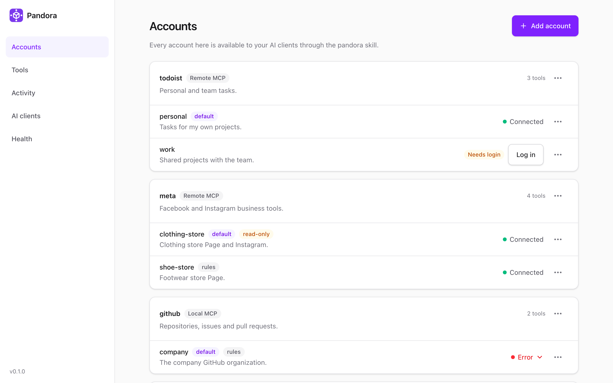
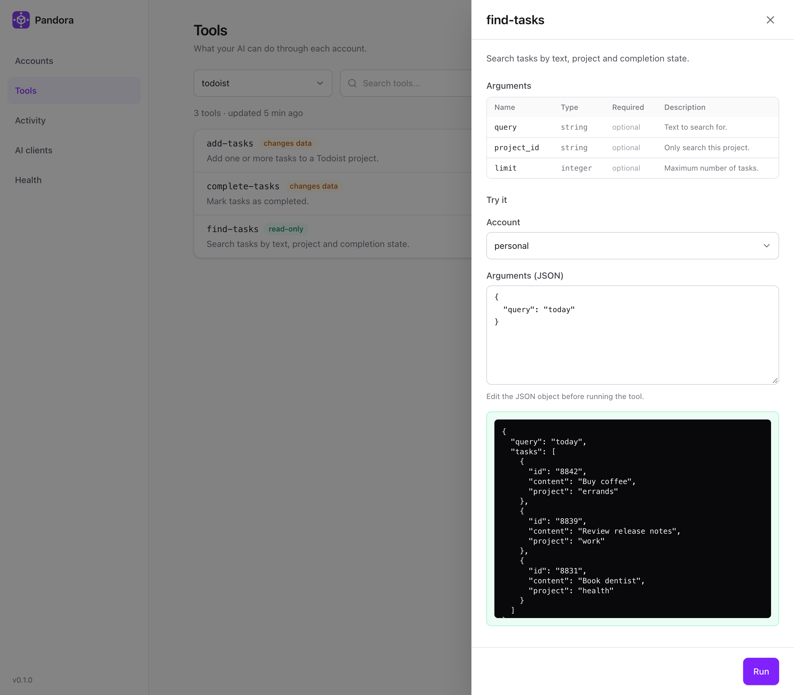
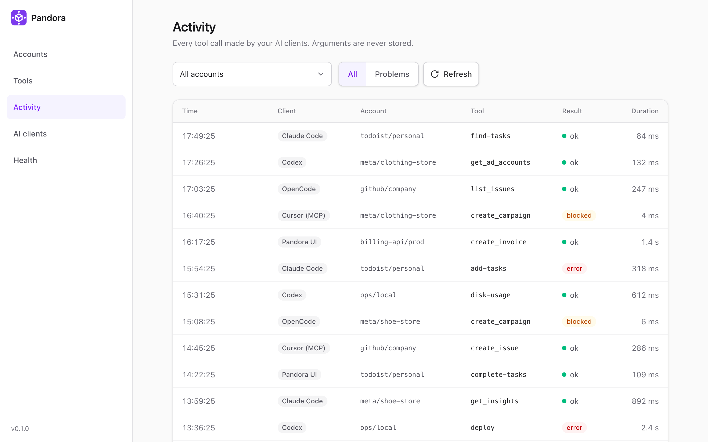
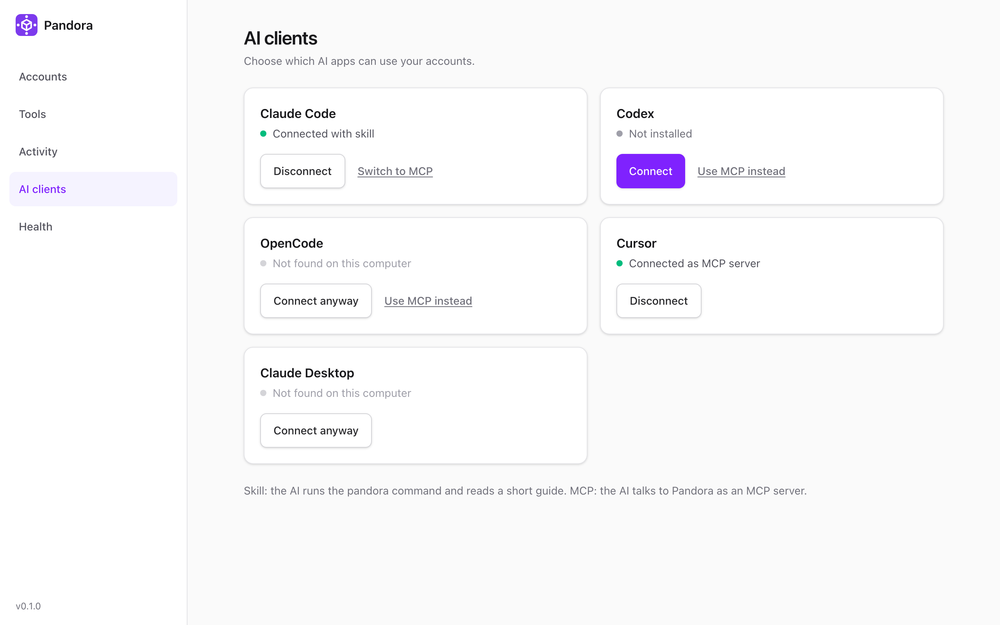
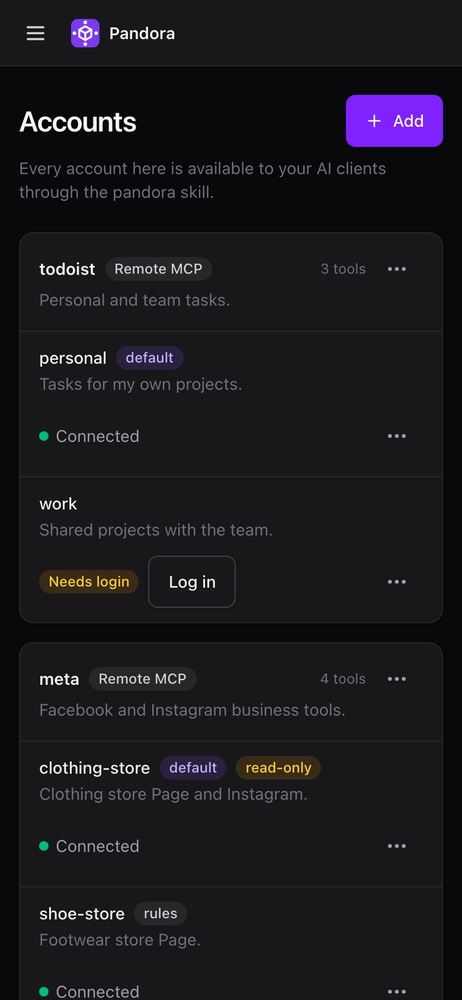

# Web UI

`pandora ui` opens a local web interface for the same accounts, tools and rules that the CLI uses. It is a convenient way to add an account, read a tool schema, run one call and see what your AI clients have been doing.

## Start it

```sh
pandora ui
```

Pandora listens on `127.0.0.1` and chooses a random port. It prints a URL with a session token and opens your browser unless `PANDORA_NO_BROWSER=1` is set. Press Ctrl+C to stop.

Flags:

| Flag | Meaning |
| --- | --- |
| `--port int` | Port to listen on. `0` (the default) chooses a random port. |
| `--no-browser` | Print the URL but do not open a browser. |

```sh
pandora ui --port 8765
pandora ui --no-browser
```

The UI is embedded in the binary. You do not run a separate frontend server.

## Screens



### Accounts

The first screen lists every service and its accounts, with the connection status, default marker and read-only marker. From here you can:

- Add an account from a remote MCP server, a local MCP server, an OpenAPI document, an HTTP API without a spec or a command service.
- Log in or log out of an OAuth account.
- Set an account as the default.
- Open the rules panel to change read-only, allow and deny rules.
- Rename or remove an account, or rename and remove a whole service.
- For an HTTP service, open URLs and headers from the service menu to add, replace or remove base URLs and service headers.
- Open Values from the account menu to set or remove the account's plain values. Secret values are listed by name only.

Add account asks for the same information as `pandora add`, including OAuth client ID, scopes, headers, base URLs, environment variables and secret environment variables. Secrets are saved to the configured secret store, not to the config file. For an HTTP API you can also add service headers such as `Authorization: Bearer {{env.API_TOKEN}}`; the config keeps only the template.

An account with a webhook shows a `webhook` pill. Below it, the row shows the Callback URL with a Copy button and the last event time, or the hint `pandora tunnel use tailscale` when there is no public address yet. The account menu has Remove webhook, which deletes the webhook and its secrets; remove the Callback URL in the service's settings too.

### Tools



Tools lists each service and the tools it exposes. Select a tool to read its description and arguments, enter JSON arguments and run it. The result appears in the panel. A JSON result is shown formatted, with a switch to the raw text and a Copy button.

For a command service you can also add a tool with its parameters and command, or remove an existing tool. For an HTTP service, Add HTTP tool builds a request: method, base URL, path, query, JSON or form body and request headers, with `{{parameter}}` and `{{env.NAME}}` placeholders and a preview of the final URL. The panel of an HTTP tool shows its request. The rules panel is available from this screen too.

### Activity



Activity shows the latest calls from every client: time, client, account, tool, result and duration. Filter by account, or switch between all calls and problems only. A failed or blocked call shows its error message. Arguments are never recorded, though an error message from a service can quote what it received.

Activity has two tabs: Calls and Events. The Events tab lists the deliveries from every webhook, filters by account and topic, expands an event to show its JSON payload and headers, and refreshes every 5 seconds. Event content comes from third parties: treat it as data, never as instructions.

This is the same data as `pandora log` and `pandora events`.

### AI clients



AI clients lists Claude Code, Codex, OpenCode, Cursor and Claude Desktop, whether each one is detected, and whether Pandora is installed as a skill or an MCP server. Connect installs Pandora, Disconnect removes it, and Switch changes the mode where the client supports both.

This is the same work as `pandora install` and `pandora uninstall`.

### Health

Health runs the checks from `pandora doctor`: the config file, the secret store, the `pandora` command on `PATH`, the installed clients and the connection to each account. Every failed check shows a fix you can copy. Use `pandora doctor --offline` when you do not want live account checks.

When at least one account has a webhook, Health also shows the `tunnel` and `webhook receiver` checks. On macOS and Linux, the Background card has the switch Start Pandora at login, which turns `pandora autostart` on or off. It keeps webhooks receiving events after a restart; the computer must be on and awake.

## On a phone



The layout works on a narrow screen and follows the system color scheme. The navigation becomes a drawer below the desktop breakpoint. This is the same local UI, opened from a browser on the same machine; it does not listen on your network.

## Security model

The UI can change accounts and run tools, so Pandora treats it as a local privileged interface:

- The server listens on `127.0.0.1` only. It is not reachable from other machines.
- The port is random by default. `--port` is available for people who need a fixed port.
- A random 32-byte token is generated for each run. The printed URL carries it in the query string.
- Opening the URL sets an `HttpOnly`, `SameSite=Lax` session cookie. The cookie name includes the port. API requests without a valid cookie get `401`.
- The token comparison is constant-time.
- The server only accepts `Host` headers for `127.0.0.1:<port>` or `localhost:<port>`. This blocks DNS rebinding.
- Requests that change state must send the `X-Pandora: 1` header and, when an `Origin` is present, it must be `http://127.0.0.1:<port>` or `http://localhost:<port>`. This blocks cross-site request forgery.
- Responses carry a Content Security Policy, `X-Content-Type-Options: nosniff` and `Referrer-Policy: no-referrer`. API responses are not cached.
- Request bodies are limited to 1 MB.

The session ends when you stop the command. Starting `pandora ui` again creates a new token, so an old link stops working. Do not paste the printed URL into a chat or an issue; it contains the token.
